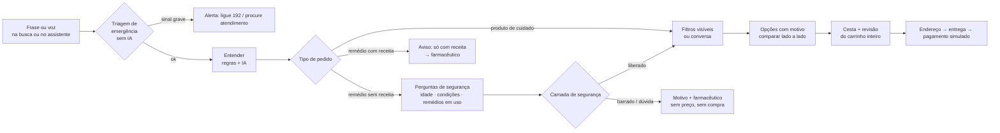
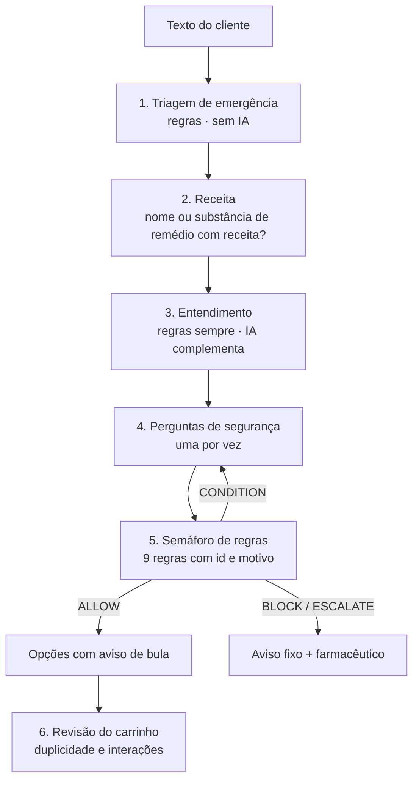
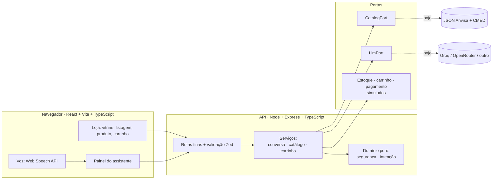

# IA Commerce — do prompt à compra, com autonomia e segurança

**Hacka Business · Desafio 2 — IA Commerce**

> Uma farmácia online em que a conversa leva à compra **sem que a IA decida o que é seguro**.
> A IA entende, pergunta e explica. **Regras testadas decidem.** Cada resposta mostra de onde veio.

> 🔒 **Confidencial.** Repositório privado, conforme o termo do desafio. **Todos os dados são públicos ou simulados:** nenhum dado, sistema ou credencial da empresa foi usado.

---

## Em 30 segundos

| | |
|---|---|
| **O problema** | As pessoas já decidem compras conversando com IAs genéricas. Em farmácia, isso é perigoso: uma IA que "recomenda" remédio sem conhecer idade, alergias, remédios em uso e limites legais é um risco para o cliente e para a empresa. E quem tem 50+ anos ou menos familiaridade digital desiste de comprar online. |
| **A resposta** | Um **motor de comércio conversacional** que descobre a necessidade, recomenda, compara e conduz até a cesta, dentro do layout de uma loja real. Segurança em saúde é **código testado no servidor**, não instrução em prompt. |
| **O que o diferencia de um chatbot** | A IA está **distribuída pela experiência** (busca, filtros, página do produto, carrinho, histórico), cada ponto com **guarda-corpos verificáveis**, e a loja **continua funcionando sem IA**. |
| **Prova** | **890 testes automatizados**, incluindo uma varredura de **8.960 conversas de saúde** conferidas por um oráculo independente, 550 conversas aleatórias (inclusive com uma IA hostil) e acessibilidade automática em cada tela. |

---

## Sumário

1. [O desafio e como respondemos, ponto a ponto](#1-o-desafio-e-como-respondemos-ponto-a-ponto)
2. [Por que isto não é "mais um chatbot"](#2-por-que-isto-não-é-mais-um-chatbot)
3. [A jornada, de ponta a ponta](#3-a-jornada-de-ponta-a-ponta)
4. [Segurança em saúde: o coração da solução](#4-segurança-em-saúde-o-coração-da-solução)
5. [IA generativa distribuída pela experiência](#5-ia-generativa-distribuída-pela-experiência)
6. [Motor de recomendação e personalização sem formulário](#6-motor-de-recomendação-e-personalização-sem-formulário)
7. [IHC, fatores humanos e acessibilidade](#7-ihc-fatores-humanos-e-acessibilidade)
8. [Arquitetura e decisões técnicas](#8-arquitetura-e-decisões-técnicas)
9. [Dados: de onde vêm e onde entram os reais](#9-dados-de-onde-vêm-e-onde-entram-os-reais)
10. [Qualidade: como sabemos que funciona](#10-qualidade-como-sabemos-que-funciona)
11. [Viabilidade, negócio e roadmap](#11-viabilidade-negócio-e-roadmap)
12. [Premissas e limites (o que dizemos com honestidade)](#12-premissas-e-limites-o-que-dizemos-com-honestidade)
13. [Como rodar, testar e publicar](#13-como-rodar-testar-e-publicar)
14. [Roteiro de demonstração em 5 minutos](#14-roteiro-de-demonstração-em-5-minutos)
15. [Mapa do repositório](#15-mapa-do-repositório)

---

## 1. O desafio e como respondemos, ponto a ponto

O enunciado pede transformar "conversas e intenções dos consumidores em jornadas de descoberta, recomendação e compra, de forma **simples, personalizada, segura e integrada**" e deixa claro: **"não se trata de construir mais um chatbot"**, e produtos de saúde exigem tratamento específico.

### O que o enunciado espera da entrega

| Aspecto pedido | Como atendemos | Onde ver |
|---|---|---|
| **Jornada ponta a ponta** | Da frase em linguagem natural (texto ou voz) à compra simulada, com os pontos de decisão do cliente: confirmar o entendimento, responder perguntas, comparar, escolher, revisar o carrinho. | §3 |
| **Experiência conversacional que vá além de responder** | O assistente **descobre a necessidade** (uma pergunta por vez), **recomenda** com o motivo e **conduz** até a cesta. Corrige-se no meio da frase ("não é para meu pai, é para minha mãe"). | §3, §6 |
| **Motor de recomendação** (contexto, histórico, adequação) | Pipeline determinístico: intenção → perguntas → filtro de segurança → ranqueamento por adequação, preço e preço por unidade → explicação. **Histórico** pelo perfil com consentimento (reposição, modo Cuidador). | §6 |
| **Tratamento de segurança em saúde** | Triagem de emergência sem IA, bloqueio de receita, **dupla checagem de tarja (Anvisa + CMED)**, semáforo de 9 regras auditáveis, encaminhamento ao farmacêutico. | §4 |
| **Integração proposta** com e-commerce, catálogo e pagamento | Arquitetura de **portas e adaptadores**; tabela "hoje → produção" linha a linha; integração em fases. | §8, §9 |

### Os critérios de avaliação específicos

| Critério do cliente | Nossa resposta |
|---|---|
| **Fluidez da jornada** | Conversa, listagem e carrinho na mesma loja; o assistente é um painel que abre sobre qualquer página e **a conversa continua** enquanto a pessoa navega. Escolher um produto o põe na cesta **sem tirar ninguém da conversa**. |
| **Qualidade e relevância da recomendação** | Ordenação pelo que a pessoa descreveu (dor de cabeça antes de dor muscular), respeito ao orçamento (nunca passa do valor), tipo de pele só quando o nome registrado afirma, preço real (CMED) para remédios. |
| **Tratamento responsável de saúde** | Ver §4. É a camada mais testada do projeto. |
| **Personalização sem formulários** | O contexto vem **da própria conversa** e do perfil com consentimento; ninguém preenche cadastro. Ver §6. |
| **Viabilidade de integração ao e-commerce** | Tudo atrás de interfaces (`CatalogPort`, `LlmPort`…). A troca da fonte não reescreve o núcleo. A 1ª fase pode chamar a busca atual da empresa com categoria, faixa de preço e marca, que já são seus filtros. |
| **Diferenciação de um chatbot convencional** | §2. |

### Os critérios gerais

| Critério | Evidência |
|---|---|
| **Inovação** | Segurança no servidor com **dupla checagem de fontes oficiais**; IA em cada ponto da experiência com **resposta verificada contra os dados**; **revisão do carrinho inteiro**; modo Cuidador. |
| **Impacto** | Inclusão de quem hoje desiste de comprar online; menos erro em um setor em que erro é risco; recompra assistida. |
| **Clareza da apresentação** | Este documento, o roteiro da §14 e a interface que **diz de onde vem cada informação**. |
| **Viabilidade** | Pequeno, modular, sem dependências exóticas; funciona sem IA; fase 1 integra sem mexer no catálogo. §11. |
| **Qualidade da solução** | 890 testes, tipos de ponta a ponta, contratos validados nas duas pontas, acessibilidade testada. §10. |

---

## 2. Por que isto não é "mais um chatbot"

| Chatbot convencional | IA Commerce |
|---|---|
| Responde perguntas | **Descobre a necessidade**, recomenda e **conduz à compra** |
| A segurança depende do texto do prompt | A segurança é **código no servidor**, testado, auditável, igual em qualquer canal |
| Uma janela de conversa isolada | **Dentro da loja**: busca, filtros, página do produto, carrinho e histórico |
| Pode inventar produto, preço ou propriedade | Só mostra o que existe nos dados; **cada frase gerada é verificada**; sem verificação, texto fixo |
| Se a IA cai, cai tudo | **Degradação segura**: sem IA, a loja segue por regras |
| Trata todos iguais | Contexto da conversa, perfil com consentimento, **modo Cuidador** (quem compra não é quem usa) |
| Resposta é caixa-preta | **"Por quê?"** em cada aviso; origem da resposta (dados / IA com base nos dados) escrita na tela |
| Um produto por vez | **Revisão do carrinho inteiro**: mesmo princípio ativo em dois produtos, dois anti-inflamatórios juntos |
| Esquece a fragilidade do público | Desenhado para **50+**: texto grande, alvos de 48 px, uma ação por tela, contraste testado |

### As cinco ideias que sustentam a solução

1. **Segurança no servidor, não no prompt.** A IA nunca decide se algo pode ser sugerido. Mesmo que ela erre, alucine ou receba texto malicioso, o pior caso é uma explicação pior: ela não consegue liberar um produto bloqueado.
2. **Duas fontes oficiais concordando.** Um remédio só é "sem receita" se a **Anvisa e a tabela CMED** disserem o mesmo. Na dúvida, exige receita.
3. **IA em todo o caminho, sempre verificável.** Filtro por frase, busca, perguntas sobre o produto, conferência pessoal, revisão do carrinho: cada ponto com limites explícitos.
4. **Honestidade como produto.** Quatro estados de resposta (encontrado, parcial, não encontrado, não confirmado), cada um com um próximo passo. "Não sei" é uma resposta válida e visível.
5. **Quem compra não é quem usa.** O modo Cuidador mantém o perfil de quem será tratado separado do de quem conversa.

---

## 3. A jornada, de ponta a ponta



### Cenário A — Fluidez: "Quero um hidratante para o rosto até R$ 20"
O assistente mostra o que entendeu (categoria e valor máximo) com **Está certo / Mudar**, faz **uma** pergunta ("sua pele é seca, oleosa ou mista?") em botões, apresenta 2 a 3 opções reais **dentro do orçamento**, com o motivo de cada uma e o preço por 100 g, compara só as diferenças e leva à cesta. Sugere um complemento (protetor solar) sem insistir.

### Cenário B — Segurança: "Meu pai tem dor de cabeça há 2 dias"
O assistente entende que o beneficiário é **o pai**, pergunta idade, há quanto tempo e condições (pressão alta, rins, estômago…), e a camada de segurança decide: com pressão alta e dois dias de sintoma, **encaminha ao farmacêutico, sem preço e sem botão de compra**; com perfil saudável e sintoma recente, mostra opções sem receita, **ordenadas pelo que serve para dor de cabeça**, com "leia a bula" e **nunca dose**.

### Cenário C — Cuidado contínuo: "Repetir minha última compra"
Com **consentimento explícito** ao perfil de demonstração, o assistente mostra o que está acabando ("comprado há 38 dias; deve acabar em 7 dias"), adiciona tudo à cesta com um toque e, **para o remédio de uso contínuo que exige receita, não o inclui** e oferece o farmacêutico. No modo Cuidador, o perfil guardado do pai dispensa repetir as perguntas.

### Cenário D — Descoberta pela loja
Categorias, filtros e busca funcionam **sem abrir a conversa**. A pessoa descreve o que quer ("shampoo barato"), a IA monta **chips de filtro editáveis**, e na página do produto ela **pergunta sobre aquele produto** ou confere **"Esse produto é para mim?"**.

### Cenário E — Emergência
"Meu pai está sem força de um lado do corpo": alerta imediato (192), **antes** de qualquer interpretação e sem depender da IA.

---

## 4. Segurança em saúde: o coração da solução

O enunciado diz que uma solução que não trate saúde "dificilmente será considerada viável". Por isso a segurança é a parte **mais** projetada e **mais** testada.



### As camadas

| # | Camada | O que garante |
|---|---|---|
| 1 | **Triagem de emergência** (regras, sem IA, roda primeiro) | Dor no peito, falta de ar, sinais de AVC (fraqueza ou dormência de um lado, boca caída, fala enrolada), convulsão, overdose, intoxicação, risco de se machucar: alerta imediato, mesmo no meio de outra pergunta. Conservadora de propósito: prefere falso alarme a ignorar. |
| 2 | **Receita** | Remédio de receita (por nome ou substância) nunca é sugerido. Não há botão de compra; o caminho é o farmacêutico. |
| 3 | **Dupla checagem de tarja** | "Sem receita" só se **Anvisa (tarja 1) E CMED ("Sem tarja") concordarem em todas as apresentações**. Divergência ou tarja não informada vira "exige receita". Os códigos de tarja foram confirmados com a própria CMED. |
| 4 | **Semáforo de regras** (9 regras) | Receita, alergia, contraindicação, interação, gravidez, criança pequena, idoso, sintoma que persiste, informação faltando. **Cada regra tem um id estável e um motivo.** Vale sempre a mais grave; uma regra nunca "desfaz" outra. |
| 5 | **"Não perguntei" ≠ "não tem"** | Alergia `undefined` (não perguntamos) pede informação; `[]` (perguntamos e não há nada) libera. Isso evita liberar por falta de pergunta. |
| 6 | **Textos de segurança fixos** | A IA nunca escreve os avisos de saúde. São textos revisáveis, marcados como pendentes de validação farmacêutica e jurídica. |
| 7 | **Conferência por produto** | "Esse produto é para mim?" roda a mesma camada **para aquele produto**, com o motivo se barrar ("uma das condições informadas é contraindicação deste produto"). |
| 8 | **Revisão do carrinho** | Mesmo princípio ativo em dois produtos (risco de excesso), dois anti-inflamatórios juntos, lembrete de conferir cada remédio sem receita. Só regras, sem dose e sem "é seguro". |

### O que a IA **nunca** faz

Decidir se um produto é seguro · escrever aviso de saúde · escolher produto que não veio da busca · informar preço, estoque ou propriedade (vêm dos dados) · alterar carrinho ou pagamento · dar dose, prometer efeito ou dizer "melhor"/"cura"/"alivia" (a verificação descarta a frase).

### Por que dá para confiar

- **Testes de propriedade** que valem em todas as combinações: remédio de receita **nunca** é liberado; nenhum motivo restritivo termina em "liberado"; toda decisão deixa pelo menos uma regra registrada; o resultado é determinístico.
- **Varredura exaustiva**: 7 sintomas × 5 faixas de idade × 4 tempos × 64 combinações de condições = **8.960 conversas**, cada produto mostrado conferido por um oráculo independente (`evaluate` direto), mais regras de ouro escritas à parte: grávida, criança pequena e sintoma de 3 dias ou mais **nunca** recebem opções.
- **IA hostil**: 150 conversas aleatórias com uma "IA" que devolve JSON absurdo, preço inventado, "tome 500 mg" e links falsos. Nenhuma passou da camada de segurança.

> As regras clínicas são de **protótipo**, a partir de fontes públicas e simplificadas. **Precisam de validação por farmacêutico e revisão jurídica antes de qualquer uso real**, e dizemos isso na própria interface.

---

## 5. IA generativa distribuída pela experiência

A IA não é uma janela de chat colada no site: está **em cada ponto onde ajuda**, e em cada um tem **limites que o código impõe**.

| Onde | O que a IA faz | Guarda-corpo |
|---|---|---|
| **Busca do cabeçalho** | Entende a frase e decide: catálogo (produto) ou conversa (saúde, receita, emergência). | Emergência e receita são detectadas por regras antes e acima da IA. |
| **Filtro por frase** | "Hidratante pele seca até R$ 20" → **chips de filtro** visíveis e removíveis. | O resultado é um conjunto de filtros que a pessoa vê e edita; nada fica escondido. |
| **Conversa** | Entende frases soltas ("uns vinte reais", "pele bem seca"), conversa com naturalidade, redige respostas. | Regras rodam sempre; a IA só preenche lacunas. Frase gerada é verificada (sem número, preço, link ou promessa de saúde fora dos dados); se falhar, entra texto fixo. |
| **Perguntas sobre um produto** | Responde com base **só** nos dados do cadastro daquele produto. | Pergunta pessoal ("posso usar com pressão alta?") **não é respondida de memória**: leva à conferência de segurança. A tela diz se a resposta veio dos dados ou foi redigida pela IA. |
| **Conferência "é para mim?"** | Conduz a conversa de perguntas de segurança. | O veredito é da camada de regras, não da IA. |
| **Carrinho** | — (regras determinísticas, de propósito) | Segurança de carrinho não deve depender de modelo. |
| **Voz** | Ditado ao vivo; leitura em voz alta; transcrição no servidor como reserva. | Erros viram mensagens que dizem o que fazer. |

### Resiliência da IA

- **Qualquer provedor** compatível com o formato OpenAI, por três linhas de `.env`; **cadeia de provedores** com reserva automática.
- **Modelos de reserva** do mesmo provedor se o principal estiver sobrecarregado (429/5xx/404); chave inválida (401/403) para na hora.
- **Tempo limite total por pedido** (não por modelo) e **disjuntor**: depois de falhas seguidas, a IA pausa e tudo segue por regras, sem a pessoa esperar.
- **Teto de chamadas por minuto** para proteger a cota gratuita; resposta repetida é instantânea (cache).
- **A IA só é chamada quando as regras não bastam**: pedidos claros ("shampoo", "azia") são entendidos na hora.
- **A chave nunca aparece** em log, erro ou na rota de saúde (`/api/health` mostra o modelo, não a chave).

---

## 6. Motor de recomendação e personalização sem formulário

### Pipeline de um turno

1. **Triagem** de emergência e de receita (regras).
2. **Entender**: extração por regras (categoria, valor máximo, tipo de pele, pessoa, sintoma, dias) + IA para o que as regras não pegam. Para segurança vale o **mais conservador**: se qualquer um vê receita ou emergência, vale.
3. **Completar**: faz **uma pergunta por vez**, só o que falta (tipo de pele, idade, condições…).
4. **Buscar** no catálogo e **filtrar por segurança** (o semáforo remove ou condiciona).
5. **Ranquear** com critério explícito: adequação ao que foi descrito, preço por unidade, disponibilidade.
6. **Explicar** com o motivo de cada opção.
7. **Conduzir**: comparar só as diferenças, cesta, revisão do carrinho, checkout.

### Adequação, não só busca

- Para **dor de cabeça**, aparecem primeiro os produtos cujo cadastro cita dor de cabeça (antes de dor muscular).
- **Tipo de pele** só conta quando o **nome registrado** o afirma. Se não cita, a tela diz "não informado". Nunca um palpite.
- **Orçamento é teto**: nunca se mostra produto acima do valor. Se nada cabe, a resposta é **parcial e honesta** ("estes são os mais baratos e passam do seu valor em R$ X").
- **Comparação** marca em cada linha o que é de fato melhor (menor preço, menor preço por 100 g), com texto, não só cor.

### Personalização sem formulário

| Fonte de contexto | Como entra |
|---|---|
| **A conversa** | O que a pessoa disse vira o resumo "Seu pedido", sempre visível e editável. |
| **Quem vai usar** | "Meu pai", "minha mãe": vale a **última pessoa citada** ("não é para meu pai, é para minha mãe"). |
| **Perfil com consentimento** | "Posso usar o histórico do perfil de demonstração?" Sim/Não. Com o sim: reposição proativa e **modo Cuidador** (idade, condições e remédios de quem é cuidado, sem repetir as perguntas). |
| **Sem retenção por padrão** | Conversas ficam em memória com teto, sem banco; dados de saúde não viram histórico permanente. |

---

## 7. IHC, fatores humanos e acessibilidade

Projetado a partir de **Nielsen, Norman e WCAG 2.2 AA**, com o público 50+ como referência de projeto (sem tratá-lo como homogêneo: os ajustes são visíveis e escolhidos pela pessoa).

### As 10 heurísticas de Nielsen, em código

| # | Heurística | Como aparece |
|---|---|---|
| 1 | Visibilidade do status | "Entendendo o seu pedido…"; etapas "Passo 2 de 3"; selos "Confirmado: em estoque" e "Prazo: informação não confirmada"; indicador "Estou ouvindo" no ditado. |
| 2 | Linguagem do mundo real | "Para quem é?", "Tem alergia?"; sem jargão de IA; termos de saúde explicados. |
| 3 | Controle e liberdade | **Voltar**, **Mudar meu pedido**, remover item, filtros removíveis por chip, **"Falar com atendente" sempre visível**. |
| 4 | Consistência | Convenções de e-commerce e de conversa; um botão principal por tela, sempre no mesmo lugar. |
| 5 | Prevenção de erros | A camada de segurança é a prevenção; confirma o entendimento **antes** de buscar; botão desabilitado **explica por quê** ("Marque 2 produtos para comparar"). |
| 6 | Reconhecimento em vez de lembrança | Respostas em botões; **resumo fixo** do pedido; chips de filtro; menu por áreas ("Ver áreas"). |
| 7 | Flexibilidade | Botões, texto ou **voz**; "repetir última compra"; filtros manuais **ou** por frase. |
| 8 | Estética e minimalismo | **Uma pergunta por vez**, 2 a 3 opções em destaque, uma ação principal por tela. |
| 9 | Recuperação de erros | Quatro estados de resposta; mensagens sem código, com o problema e o próximo passo; **nenhum beco sem saída** (verificado automaticamente). |
| 10 | Ajuda e documentação | "Por quê?" em cada aviso; "Como funciona" na entrada; origem da resposta dita na tela; atendimento humano. |

### Fatores humanos → decisões de projeto

| Fator | Decisão |
|---|---|
| Visão | Texto de corpo ≥ 18 px (escala até 150%), contraste ≥ 4,5:1 **testado**, **alto contraste** em um toque. |
| Destreza | Alvos de toque ≥ 48 px; nada de arrastar nem gestos escondidos. |
| Memória de trabalho | Resumo do pedido fixo; comparação lado a lado; filtros visíveis. |
| Literacia digital e em saúde | Ícone **sempre** com rótulo de texto; palavras do dia a dia; termos técnicos explicados. |
| Ansiedade e medo de errar | Voltar e desfazer em todo passo; nada irreversível sem aviso; checkout **declaradamente simulado**. |
| Confiança | Identidade clara do assistente; diz o que é IA e o que são dados; atendimento humano visível. |
| Tempo de leitura | **Sem carrossel automático**, sem sessão que expira, sem conteúdo que muda sozinho; aviso de "adicionado à cesta" fica até ser dispensado. |
| Variação sensorial | Texto, voz (ditar e ouvir) e toque **equivalentes**; estados nunca dependem só de cor. |

### Norman: modelo conceitual, affordances e golfos
- **Modelo conceitual**: "converso, vejo opções, escolho, pago". Botões **parecem botões**, com verbo ("Adicionar à cesta", "Esse produto é para mim?").
- **Golfo de execução** reduzido por sugestões em botões; **golfo de avaliação** reduzido pelo resumo "Entendi que você quer…" e por feedback imediato.
- **Restrições** que guiam sem bloquear; **mapeamento natural** na comparação (atributos alinhados).

### Acessibilidade testada, não prometida
- **axe-core** automatizado em cada tela e estado (home, conversa, saúde, catálogo, produto, carrinho, checkout com erros).
- **Contraste verificado por teste** nos dois temas (padrão e alto contraste).
- Foco levado ao conteúdo ao trocar de tela; `aria-live` para avisos; `role="alert"` apenas para emergência; respeita `prefers-reduced-motion`.
- Linguagem do layout da loja **mantida**, com tamanhos e alvos acessíveis.

---

## 8. Arquitetura e decisões técnicas



### Decisões e por quê

| Decisão | Motivo | O que descartamos |
|---|---|---|
| **TypeScript em tudo** + `packages/shared` | O contrato entre tela e API é **um só arquivo** validado nas duas pontas. Erro de contrato vira erro de compilação. | Contratos duplicados à mão. |
| **Domínio puro** (`domain/`) sem banco, rede nem IA | A segurança se testa **sem rede**, em milissegundos, e as fontes de dados trocam sem tocar nas regras. | Lógica de segurança misturada com chamadas de IA. |
| **A IA redige; as regras decidem** | A única forma de a segurança valer em qualquer canal e resistir a erro do modelo. | Segurança por instrução de prompt. |
| **Portas e adaptadores** | A integração real vira **trocar um adaptador**, não reescrever. É o argumento central de viabilidade. | Acoplamento direto ao provedor ou ao catálogo. |
| **UI guiada por contrato**: a API devolve turnos tipados e a tela só renderiza | Nada de lógica de negócio na tela; os 4 estados de resposta são **tipos**, não improviso. | Tela decidindo regra. |
| **Provedor de IA configurável** com cadeia, disjuntor e teto | IA gratuita é instável: a experiência não pode depender de um provedor. | Dependência de um único modelo. |
| **Sem banco** no protótipo | Catálogo pequeno e estático; menos peças, menos risco. O ponto de troca está pronto (`CatalogPort`). | Postgres, filas, vetores: aumentariam risco sem ganho agora. |
| **Site e API no mesmo processo** | Um endereço, sem CORS, publicação simples. | Dois serviços para sincronizar. |
| **Busca e filtros determinísticos** | Previsível e testável; a IA entra para interpretar a frase, não para ordenar. | Busca vetorial: entra em produção, sobre o catálogo real (ver §11). |

### Segurança da aplicação
Cabeçalhos de segurança e CSP, CORS restrito, limite de tamanho de corpo, limite de requisições, validação de toda entrada (Zod), erros sem detalhe técnico para o cliente, segredos só em variáveis de ambiente (`.env` ignorado pelo Git), texto do cliente tratado sempre como **dado**, nunca como instrução, e rota de áudio que só repassa e descarta.

---

## 9. Dados: de onde vêm e onde entram os reais

O enunciado pede dados públicos ou simulados, **assumindo explicitamente onde entrariam os reais**.

### Fontes (todas públicas)

| Fonte | Uso | Tratamento |
|---|---|---|
| **Anvisa: cadastro de cosméticos** (1,2 milhão de linhas) | Nome, fabricante, situação do registro | Leitura em streaming (Windows-1252), filtro de "ativo", classificação em **14 categorias** pelo nome, **tipo de pele só quando o nome afirma**, amostra variada e reproduzível. Resultado: **162 produtos**. |
| **Anvisa: cadastro de medicamentos** (229 mil linhas) | Nome, princípio ativo, categoria regulatória, tarja | Curadoria de contraindicações e interações **por substância**; só entra produto cujas substâncias todas conhecemos. Resultado: **72 produtos** em 7 grupos. |
| **CMED: lista de preços** (26.635 apresentações, 09/10/2026) | **Preço máximo ao consumidor (PMC)**, apresentação, EAN, tarja | Cruzamento exato pelos 9 primeiros dígitos do registro. Preço mostrado = PMC da apresentação mais barata, **identificado como tal**. |

Os arquivos originais, comprimidos, estão em `data/raw/` com **SHA-256** e como regenerar. Os scripts de tratamento estão em `apps/api/scripts/`.

### Do dado simulado ao real (integração proposta)

| Hoje (hackathon) | Em produção | Como troca |
|---|---|---|
| Catálogo: cadastros públicos da Anvisa | API de catálogo da empresa | Novo adaptador de `CatalogPort` |
| Preço de medicamento: **PMC da CMED** (teto regulado) | Preço e promoções da empresa | Mesma porta; muda a fonte |
| Preço de cosmético: simulado | Preço da empresa | Idem |
| Estoque e prazos: simulados | Estoque e disponibilidade por CEP | Nova porta de estoque |
| Contraindicações e interações: curadoria de protótipo | **Base clínica licenciada**, validada por farmacêuticos | Substitui a tabela de regras; os testes continuam valendo |
| Perfil e histórico: sintéticos, com consentimento simulado | Conta do cliente, com consentimento (LGPD) | Nova fonte de perfil |
| Carrinho no navegador; checkout simulado | API de carrinho e gateway existentes | Portas de carrinho e pagamento |
| IA: provedor gratuito | Provedor corporativo aprovado | 3 variáveis de ambiente |

### Integração em fases (sem reconstrução)
1. **Camada conversacional sobre a busca atual**: a IA transforma a frase em categoria, faixa de preço e marca, que **já são os filtros existentes**. Não altera o catálogo.
2. **Atributos de necessidade** (tipo de pele, indicação) e estoque por CEP.
3. **Conta, recompra e assinatura**, com consentimento.
4. **Canais externos** (WhatsApp, assistentes de IA) reutilizando o **mesmo motor**, por exemplo por servidor MCP.

---

## 10. Qualidade: como sabemos que funciona

**890 testes automatizados** (5 de contrato · 753 de API · 132 de interface), em 39 arquivos. Rodam em segundos e **sem rede**.

| Frente | O que cobre |
|---|---|
| **Segurança (tabela de casos)** | casos nomeados + propriedades universais (receita nunca liberada; nenhum motivo restritivo termina em "liberado"; toda decisão deixa regra para auditoria; determinismo). |
| **Varredura exaustiva de saúde** | **8.960 conversas** (7 sintomas × 5 idades × 4 tempos × 64 combinações de condições) + 64 combinações de alergia e remédio em uso, com **oráculo independente**. |
| **Corpus de frases** | Um corpus de frases reais e hostis: emergências em MAIÚSCULAS e sem acento, remédios de receita por nome, injeção de instrução, HTML, SQL, emoji, frase de 500 letras, orçamento R$ 0 e R$ 99.999. |
| **Conversas aleatórias** | 550 conversas com semente fixa (400 só com regras; 150 com uma **IA hostil**): sempre contrato válido, **nunca beco sem saída, dose, preço inventado ou produto de receita**, resposta em < 0,5 s. |
| **Dados** | Tratamento de Anvisa e CMED, dupla checagem de tarja, preço = PMC, ids únicos, sem texto corrompido, origem rastreável. |
| **IA** | Provedor (reserva, 429, 401, tempo total, disjuntor, teto), entendimento (regras vencem a IA), verificação de frases geradas. |
| **Interface** | Telas, jornada completa da frase ao pedido, **axe-core** em cada tela, contraste nos dois temas, ditado (incluindo erros e microfone bloqueado). |

Nada disso mede o que **só pessoas** medem: legibilidade em tela real, uso com leitor de tela e teste com público 50+ (ver §12).

---

## 11. Viabilidade, negócio e roadmap

### Valor

| Para quem | Valor |
|---|---|
| **Cliente 50+ e cuidador** | Autonomia, clareza e segurança para comprar sem depender de outra pessoa. |
| **A empresa** | Presença onde a decisão acontece; **menos abandono** por dificuldade de navegação; **recompra assistida**; segurança como marca, ligada à rede de farmacêuticos (a IA **encaminha** ao farmacêutico, não o substitui). |
| **Sociedade** | Inclusão digital e acesso mais compreensível e responsável a produtos de saúde (ODS 3 e 10, como contribuição potencial). |

A pesquisa da equipe aponta sinais de mercado favoráveis (fontes secundárias, para ler como indicativos): a maioria dos varejistas já adotou IA; mais de 70% de abandono de carrinho em lojas virtuais; e o custo de reter um cliente é menor que o de adquirir um novo.

### Como mediríamos (sem prometer números)
- **Busca com resultado útil** e **tarefa concluída sem ajuda**.
- **Esforço** (passos até a cesta) e **abandono de carrinho**.
- **Recuperação**: quando não há correspondência exata, a pessoa entende e continua?
- **Segurança**: casos bloqueados corretamente, encaminhamentos ao farmacêutico e **zero recomendação indevida** na suíte.
- **Confiança e usabilidade**: pergunta "você compraria assim?" e questionário SUS.

### Riscos e mitigação

| Risco | Mitigação |
|---|---|
| Alucinação | A IA não decide; frase verificada contra os dados; texto fixo de reserva. |
| Responsabilidade regulatória | Limites claros, encaminhamento ao farmacêutico, **validação farmacêutica e revisão jurídica antes de produção**. |
| Privacidade (LGPD) | Consentimento explícito, mínimo necessário, sem histórico de saúde por padrão. |
| Integração com legado | Portas com interface definida; fases; fase 1 não altera o catálogo. |
| Dependência de provedor de IA | Cadeia de provedores, disjuntor, modo por regras. |
| Estereótipo do público 50+ | Ajustes visíveis e opcionais; comunicação como "experiência acessível para todos". |

### Roadmap
1. **Fase 1 — piloto no site**: categorias de cuidado e remédios sem receita, busca e filtros por frase, revisão do carrinho.
2. **Fase 2 — cuidado contínuo**: conta real, histórico e reposição com consentimento, perfis de cuidador guardados.
3. **Fase 3 — outros canais e acessibilidade ampliada**: WhatsApp e assistentes externos sobre o mesmo motor; **Libras**; busca semântica sobre o catálogo real, ainda **filtrada pela segurança**; painel de métricas.

---

## 12. Premissas e limites (o que dizemos com honestidade)

Confiança vem de dizer o que **não** fizemos.

- **Regras clínicas simplificadas.** Feitas de fontes públicas, **sem validação farmacêutica nem revisão jurídica**. Os textos de segurança estão marcados como pendentes. A tabela de interações é uma curadoria **por substância**, pequena e declarada.
- **Preços.** Medicamentos: **PMC da CMED**, que é o **teto legal**, não o preço de uma rede. Cosméticos: **simulados**. Estoque, prazos de entrega e frete: **simulados**.
- **Pagamento e atendimento.** Checkout, pagamento e "falar com atendente/farmacêutico" são **simulados** e dizem isso na tela.
- **Fotos de produtos.** Parte vem de divulgação das marcas, **só para esta demonstração** (veja `apps/web/src/assets/img/products/README.md`). Substituir antes de qualquer uso público. As demais imagens usam ilustração genérica.
- **IA gratuita.** Planos gratuitos podem registrar o que é enviado: use frases de exemplo. Pode haver lentidão ou limite; por isso a loja funciona por regras.
- **Memória.** Conversas ficam na memória do servidor, com teto; reiniciar apaga. Sem banco por decisão de escopo.
- **Ainda não houve teste de usabilidade com pessoas 50+.** O desenho segue Nielsen, Norman e WCAG, e a acessibilidade automatizada passa, mas isso **não substitui** observar pessoas reais. É o próximo passo previsto.
- **Interpretação de campos públicos.** O filtro "ativo" do cadastro da Anvisa e a escolha de ICMS 18% na CMED são interpretações nossas, documentadas; confirme com a documentação oficial antes de produção.
- **Licenças.** Dados públicos, mas confirme termos de uso no portal antes de usar além do hackathon.

---

## 13. Como rodar, testar e publicar

**Requisitos:** Node 20+.

```bash
npm install
cp .env.example .env     # opcional: sem chave, tudo funciona por regras
npm run dev:all          # site: http://localhost:5173 · API: http://127.0.0.1:4100
```

### Ligar a IA (opcional)
Qualquer provedor compatível com o formato "chat completions" da OpenAI. No `.env`:

```
LLM_BASE_URL=...        LLM_API_KEY=...        LLM_MODEL=...
LLM_FALLBACK_MODELS=...  # modelos de reserva do mesmo provedor
LLM2_BASE_URL=... LLM2_API_KEY=... LLM2_MODEL=...   # segundo provedor (reserva)
LLM_EXPLAIN=false        # true: a IA também redige a frase de abertura das opções
```

```bash
npm run ai:check         # testa a conexão e o entendimento (nunca imprime a chave)
```

### Testar

```bash
npm test                 # 890 testes (contrato, API, interface)
npm run typecheck
```

### Publicar (site + API em um endereço só)

```bash
npm ci && npm run build   # gera apps/web/dist
HOST=0.0.0.0 npm run start
```

`render.yaml` traz um exemplo. Preencha as variáveis de IA no painel da hospedagem (nunca no repositório). **Serviços gratuitos "dormem"**: abra o endereço alguns minutos antes de demonstrar.

### Scripts úteis

| Comando | O que faz |
|---|---|
| `node --import tsx apps/api/scripts/buildCosmeticsCatalog.ts` | Regenera o catálogo de cosméticos a partir do dado bruto da Anvisa |
| `node --import tsx apps/api/scripts/buildMedicinesCatalog.ts` | Regenera o de medicamentos (Anvisa + CMED) |
| `npm run images:find` / `images:apply` | Busca fotos em fontes abertas com **revisão humana** (veja `docs/fotos-de-produtos.md`) |

---

## 14. Roteiro de demonstração em 5 minutos

| Tempo | O que mostrar | O que dizer |
|---|---|---|
| 0:00 | Uma filha comprando remédio para o pai e uma IA genérica dando resposta perigosa | A dor real: IA genérica em saúde. |
| 0:45 | Loja com o assistente embutido | A empresa precisa levar a **sua segurança** para onde a decisão acontece. |
| 1:15 | **Cenário B**: "meu pai tem dor de cabeça há 2 dias" → perguntas → pressão alta → farmacêutico, sem preço | **A IA não decide a segurança.** Quem decide é uma camada testada. |
| 2:15 | Perfil saudável: opções por **adequação**, "leia a bula", sem dose; **"Por quê?"** | Cada aviso diz o motivo e a origem. |
| 2:45 | **Cenário A** na loja: filtro por frase vira **chips**; página do produto; pergunta sobre o produto | IA **em cada ponto**, sempre verificável. |
| 3:30 | Carrinho com a **revisão do carrinho** (mesmo princípio ativo em dois produtos) | Segurança no conjunto da compra. |
| 4:00 | **Cenário C**: histórico com consentimento, reposição, remédio de receita fora da lista | Personalização **sem formulário**, com consentimento. |
| 4:30 | Slide de arquitetura e "dado simulado → real"; **890 testes**, 8.960 conversas de saúde | Viável: troca de adaptador, não reescrita. Honestidade: o que é simulado. |
| 4:55 | "Da intenção à compra, com autonomia e com segurança." | |

**Frases de teste para a gravação** (use exatamente): `hidratante para o rosto até 20 reais` · `meu pai tem dor de cabeça há 2 dias` · `quero amoxicilina` · `repetir minha última compra` · `estou com azia`.

---

## 15. Mapa do repositório

```
.
├─ apps/
│  ├─ api/                      # Node + Express + TypeScript
│  │  ├─ data/                  # catálogos tratados (cosméticos, medicamentos)
│  │  ├─ scripts/               # tratamento de dados, teste de IA, busca de fotos
│  │  └─ src/
│  │     ├─ domain/             # PURO: sem banco, rede nem IA
│  │     │  ├─ safety/          #   semáforo de 9 regras, emergência, textos fixos
│  │     │  └─ intent/          #   extração por regras + entendimento (regras + IA)
│  │     ├─ ports/              # interfaces: catálogo, IA
│  │     ├─ adapters/           # catálogo (JSON), IA (provedores, cadeia, reserva)
│  │     ├─ catalog/            # tratamento Anvisa/CMED, fotos
│  │     ├─ services/           # conversa, produtos, carrinho, verificação de frases
│  │     └─ routes/             # rotas finas
│  └─ web/                      # React + Vite
│     └─ src/
│        ├─ layout/             # cabeçalho, categorias, rodapé, carrossel
│        ├─ pages/              # home, catálogo, produto, carrinho, checkout
│        ├─ assistant/          # painel do assistente (a conversa vive aqui)
│        ├─ components/         # chat, produto, segurança, catálogo, carrinho
│        ├─ a11y/               # barra de acessibilidade, voz, preferências
│        └─ styles/             # tokens de design (contraste testado)
├─ packages/shared/             # contratos Zod compartilhados (única fonte de verdade)
├─ data/raw/                    # dados brutos comprimidos (Anvisa, CMED) com SHA-256
├─ docs/                        # dicionário de dados e guia de fotos
├─ render.yaml                  # exemplo de publicação
└─ .env.example                 # variáveis (sem valores)
```

**Documentos de apoio:** `data/raw/anvisa/README.md` e `data/raw/cmed/README.md` (origem e tratamento dos dados) · `docs/fotos-de-produtos.md` · `apps/web/src/assets/img/README.md` (espaços de imagem da loja).

---

> **Da intenção à compra, com autonomia e com segurança.**
